  

## 🕹️ Latest projects

<table>
  <tr>
    <td width="50%" valign="top">
      
      <h3><a href="https://github.com/matthiasak/gibbs">gibbs</a> · Rust</h3>
      Autonomous universal inference engine &amp; JIT megakernel runtime. An architecture-agnostic, zero-overhead inference compiler for universal hardware acceleration that treats token generation as an irreversible flow toward minimum free energy (dG ≤ 0). GPU-lowered model families include Gemma4, Qwen35, T5, Idefics3/SigLIP and BERT-style classifiers.
    </td>
    <td width="50%" valign="top">
      
      <h3><a href="https://github.com/matthiasak/kea">kea</a> · Swift</h3>
      A small, cheeky Mac browser with nothing in the way. ~3 MB of native WebKit + SwiftUI, Ubi Chat contextual AI (Ollama, LM Studio, any OpenAI-compatible server, or cloud models), Chrome extensions without Chrome, and no telemetry: clone it, <code>./build.sh</code>, own the binary.
    </td>
  </tr>
</table>
